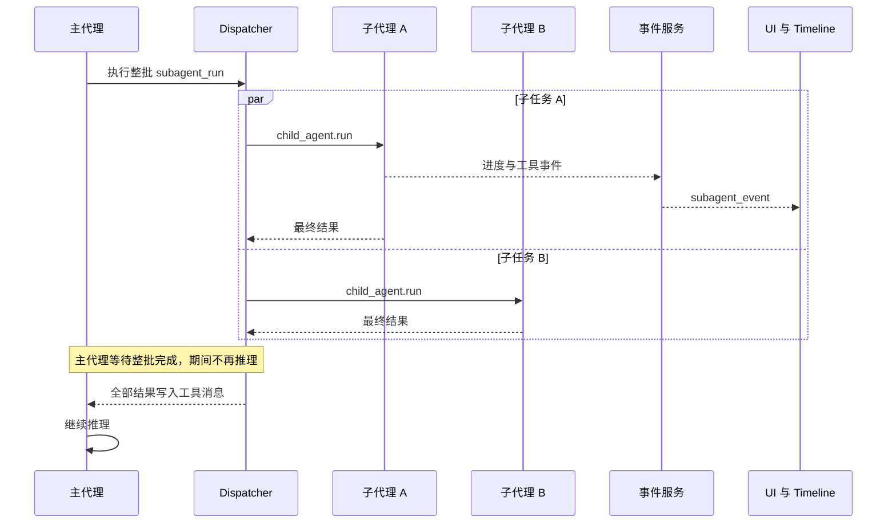

# 子代理协作界面与双向通信方案

日期：2026-10-14。状态：用户已确认并完成实施与验证，并授权提交；尚未发布安装包。

用户已确认优先实现主代理与子代理自动双向沟通，支持进展汇报、提问与追加指令。界面沿用中性黑白主题和玫瑰色强调，形成清晰、紧凑的协作工作区。

## 实施前的执行方式为何限制沟通

原有子代理可以并行执行，界面也能实时看到轨迹。但是主代理把子代理当作同步工具，等待整批工具结束后才继续推理。以下记录描述实施前的行为；同步 `subagent_run` 仍保留这一合同，新协作工具提供独立的异步路径。



`SubagentRegistry` 在内存中维护子代理身份与状态。事件通道把进度送到界面和 Timeline；父代理上下文只接收最终工具结果。LLM 调用前没有邮箱读取逻辑，子代理提示词也没有提问与等待协议。

实施前发现的问题确定了本次变更的边界，相关模块如下：

- [subagent.py](D:/code/AgentNexus/agentnexus/tools/subagent.py) 等待子代理完整运行结束。
- [dispatcher.py](D:/code/AgentNexus/agentnexus/tools/dispatcher.py) 收集整批工具结果。
- [subagents.py](D:/code/AgentNexus/agentnexus/services/subagents.py) 原来只接收展示事件，没有消息收发接口。
- [confirm_bridge.py](D:/code/AgentNexus/agentnexus/tools/confirm_bridge.py) 的取消上下文和子代理上下文原来使用共享单槽，多会话重叠时可能覆盖；本次改为按上下文隔离。
- [timeline.py](D:/code/AgentNexus/agentnexus/observability/timeline.py) 的展示事件写入会吞掉存储错误；新增消息与回执使用独立的严格事务。
- [SubagentPage.tsx](D:/code/AgentNexus/desktop/src/pages/SubagentPage.tsx) 原来的历史响应可能覆盖实时内容，切换代理时也未完整重置视图状态；本次统一归并并按身份重置。

## PRD

### 目标

在桌面会话的同一父运行内，主代理可以启动多个子任务并继续处理协作消息。子代理能汇报阶段进展、提出问题、收到答复和追加指令。用户能看清任务分工、待处理问题、通信记录、执行过程与结果。

### 本期不做

- 任意子代理之间的网状通信、跨机器执行和脱离父运行的常驻任务。
- 服务重启后自动续跑模型或工具。
- 强制抢占正在执行的 LLM 请求或工具操作。
- 暂停恢复、分支合并，以及 CLI 和 TUI 的界面重做。
- 全站主题重设计和与协作无关的新功能。

### 验收标准

1. 主代理启动两个子任务后能继续推理。一个子代理提出问题时，等待中的主代理恢复推理并答复，另一个子任务继续运行。
2. 主代理追加指令后，子代理在下一次安全边界读取指令。界面准确区分已排队、已进入上下文与投递失败。
3. 问题与答复通过明确 ID 关联。并发问题、超时问题和旧执行尝试的回复不能串线。
4. 重要消息先成功落盘，再确认发送和唤醒接收者。存储不可用时明确失败，同一请求重试不重复注入上下文。
5. 两个会话同时运行时，消息、事件、取消和审批归属正确；子代理继承对应工作区，工具白名单与递归限制保持有效。
6. 父取消、子超时、重试和服务重启都有明确终态。界面不能把仍在取消的 worker 显示成已经退出。
7. 历史回放、实时消息与断线补取统一去重；切换代理不残留旧内容，阅读历史时不强制滚到底部。
8. 列表与详情同时支持鼠标和键盘。正文与结果可读，状态有文字标识，动效尊重减少动效设置。

## 方案比较与推荐

已独立设计两种结构，并按通信闭环、现有执行约束、可靠性、接口和迁移风险比较。

| 方案 | 核心结构 | 代价 | 建议 |
| --- | --- | --- | --- |
| A：受管理子任务与邮箱 | 保留同步 ReAct；子任务启动后返回身份；消息和状态变化唤醒等待中的代理 | 增加任务生命周期、可靠邮箱与安全点读取 | 本期采用 |
| B：统一轮次协调器 | 一个父运行协调器推进所有代理 FSM；worker 只返回模型或工具结果 | 需提取可暂停 FSM，迁移模型与工具 I/O 合同 | 留给需要更广泛调度能力时评估 |

A 能让原主代理回答子问题，并复用现有工具批次和审批执行路径。B 也能完成目标，但会修改核心 FSM 的运行方式。当前需求不需要承担这部分迁移。独立评审按五项设计标准给 A 21/25、B 17/25，并同样推荐 A；该评分评估设计，不代表实现验证。

采用 A 的任务与邮箱结构。吸收 B 的问题状态与消息状态分离、完整工具批次后继续推理，以及迟到结果隔离。问题优先唤醒，普通进展合并进入下一轮。

拒绝两个候选中的具体设计：追加指令默认撤销待答问题，以及同名 `subagent_run` 在不同入口返回不同含义的结果。前者会错误关闭仍有效的问题，后者会让提示词和调用者依赖入口差异。

两种方案都不能在一次模型请求或普通长工具的执行过程中立即让该代理回复。消息会实时展示，代理在当前操作完成后的安全边界读取。

## 已实现接口与消息合同

现有 CLI 和 TUI 的同步 `subagent_run` 返回合同保留。桌面端有运行管理上下文时提供异步协作工具，避免同名工具在不同入口返回含义不同的数据。

父代理提供 `subagent_start`、`subagent_send` 和 `subagent_wait`。子代理提供 `subagent_report` 与 `subagent_ask`。调用者先启动子任务，等待新消息或状态变化，再回答对应问题。以下是调用流程示意，具体参数以工具 schema 为准：

```text
child = collaboration.start(task)
receipt = collaboration.send(child, instruction, request_id)
activity = collaboration.wait(children, timeout)
reply_receipt = collaboration.send(child, reply_to_question, request_id)
```

接口隐藏 future、数据库游标、条件变量、容量管理和事件发布。调用者不能自行指定发送者身份，也不能取得不属于本父运行的子任务句柄。

身份与消息状态按以下领域结构隔离：

```text
Endpoint = ParentEndpoint(session_id, parent_run_id)
         | ChildEndpoint(session_id, parent_run_id, subagent_id, child_run_id)
Message = Progress | Question | Reply(question_id) | Instruction | Result
Delivery = Queued | Applied(step_id) | Rejected(reason)
Question = Open | Answered(reply_id) | Expired | Closed(reason)
```

不同执行尝试使用不同 `child_run_id`。消息状态和问题状态分别建模，问题进入上下文不代表已经得到答复。接收者只能由自己的运行线程修改 `ctx.messages`，其他线程只投递消息并发出唤醒信号。

| 状态 | 精确含义 |
| --- | --- |
| 已排队 | 正文与路由身份已成功持久化，等待接收者读取 |
| 已进入上下文 | 消息已进入接收者下一轮上下文，或关联回复已进入提问工具结果；不代表任务已执行 |
| 投递失败 | 接收者已结束、问题失效、执行尝试不匹配，或无法保存；展示明确原因 |

消息与回执使用独立的严格事务写入方法，复用现有 SQLite 存储。新增记录采用追加方式，不重写或删除现有历史。发送请求以稳定 ID 幂等处理，重复 ID 搭配不同正文必须拒绝。

消息提交成功后才唤醒接收者。WebSocket 和 Timeline 是持久记录的展示视图，不参与判定代理是否收到消息。接收者按顺序读取，在本次运行内按 message_id 去重。回执写入失败时不能继续下一轮推理并假装已应用。

LLM 调用前和完整工具批次结束后读取邮箱。必须先补齐原工具批次的全部结果，不能在模型上下文中存在未完成工具调用时启动新轮次。回复若已进入提问工具结果，不再作为普通邮箱消息重复注入。

追加指令不能伪装成问题答复，也不能默认关闭一个无关的待答问题。等待接收者在安全边界读取新指令并重新判断任务，问题只有在收到关联答复、超时或明确关闭时结束。

## 运行生命周期

| 情况 | 本期行为 |
| --- | --- |
| 主代理等待子任务 | 新问题、目标状态变化或等待期限到达时返回主代理；空闲等待不轮询消耗推理步骤 |
| 子代理等待答复 | 等待计入该执行尝试的 deadline，新指令能唤醒接收者重新判断，不能无限挂起 |
| 主代理准备结束 | 尚有活动子任务或待答问题时先处理并汇总；正常结束不能静默遗留任务 |
| 主代理取消或失败 | 封闭运行，拒绝新消息，关闭待答问题并传播子取消；审批撤销继续走原有机制 |
| 子代理超时或取消 | 区分请求已接受、取消中和实际终态；超过宽限仍未退出时显示未完成清理，保留容量占用与隔离 |
| 子代理重试 | 新执行身份和邮箱；旧未读消息不自动投递到新尝试，父代理决定新的任务与需继承的指令 |
| 服务重启 | 历史可回放，原活动任务显示中断，未投递消息关闭；由用户新开运行，不自动重放有副作用的工具 |

每个父运行管理有限的子任务、并发 worker、邮箱容量和等待期限，复用现有并发与 timeout 设置。子 worker 必须继承对应工作区、trace、审批和取消上下文，不能继续依赖共享单槽。

## 协作工作区

界面保留现有应用导航。主聊天中的子任务摘要可以打开协作工作区，子代理原详情链接继续可达。

```text
会话 / 协作工作区                              返回主对话
┌───────────────────┬─────────────────────────────────────┐
│ 代理列表          │ 当前代理 · 角色 · 状态 · 耗时        │
│ 搜索与状态筛选    │ 完整任务说明 · 当前工具 · 已用步骤   │
│                   ├─────────────────────────────────────┤
│ 恢复核对          │ 待答问题与关联回复                   │
│ 等待答复 · 1 问题 │                                     │
│                   │ 通信记录   执行过程   结果           │
│ 接口实现          │                                     │
│ 运行中 · 最新进展 │ 主代理 → 子代理：追加要求             │
│                   │ 子代理 → 主代理：问题与进展           │
│ 已结束任务        │ 发送时间 · 已排队 / 已进入上下文      │
│                   │                                     │
│                   │ 补充要求                       中断  │
└───────────────────┴─────────────────────────────────────┘
```

列表显示任务、角色、执行状态、最新进展和待答数。待处理问题优先呈现，耗时与步骤作为辅助信息。不要把 token 流、工具输出和协作消息混成一条聊天记录。

通信视图显示真实发送者、接收者、问题关联和投递状态。执行视图复用现有工具呈现与 Timeline 高级上下文入口。结果视图复用 Markdown 渲染，展示结论、错误和结束原因。

桌面宽屏显示列表与详情，窄窗可在列表和详情之间切换。操作使用语义链接和按钮，阅读区采用足够对比度的正文颜色。用户离开底部后停止自动滚动，并显示新内容提示。

历史分页、实时事件和断线补取进入同一会话状态模型，按运行身份与稳定记录 ID 归并。迟到的 HTTP 响应不能覆盖较新的状态，REST 补取能纠正遗漏的终态。中断请求在收到接受回执后显示取消中，发送失败时保留重试入口。

## 4+1 实施计划

### 1. 目标

完成桌面会话内自动主子通信、可靠投递和协作工作区，满足上述八项验收标准，并修复直接影响协作可信度的隔离与回放问题。

### 2. 非目标

本期不扩展到任意代理网络、跨进程续跑、强制抢占、暂停恢复或全站视觉重做。CLI 和 TUI 保留已有同步调用合同。

### 3. 受影响模块

| 模块 | 责任 |
| --- | --- |
| `tools/confirm_bridge.py`、`services/chat.py` | 按运行绑定子代理和取消上下文，确保结束与清理互不覆盖 |
| `services/subagents.py`、`services/collaboration.py` | 子任务身份、后台生命周期、邮箱、等待和唤醒 |
| `observability/timeline.py` 与存储扩展 | 严格消息写入、回执、幂等查询和历史视图 |
| `tools/subagent.py`、`tools/collaboration.py`、`tools/providers/subagent_provider.py`、`tools/registry.py` | 异步协作工具与子代理工具注册、共享并发池、工具清理追踪，复用已有 child 构造 |
| `agents/re_act_agent.py` | 安全边界读取，问题答复、结果归并和结束约束 |
| `server/routes/chat.py`、`desktop/src/services/api.ts`、`desktop/src/services/ws.ts` | 验证输入、消息查询与操作回执、实时投影 |
| `desktop/src/services/subagentWorkspace.ts`、`collaborationStore.ts`、`useSubagentWorkspace.ts`、`components/session/SessionManager.tsx` | 会话级协作数据、边界解析、历史与实时归并 |
| `desktop/src/components/layout/InfoPanel.tsx`、`Sidebar.tsx`、`desktop/src/pages/SubagentPage.tsx`、`styles/globals.css` | 列表、详情、待答问题、协作入口与主题可读性 |
| 后端单元与集成测试、desktop 单元与端到端测试 | 通信闭环、隔离、错误与恢复回归 |

### 4. 回滚策略

新增协作能力由后端 `subagent_collaboration_enabled` 开关控制工具暴露，默认开启，并向界面提供对应能力状态。设置环境变量 `AGENTNEXUS_SUBAGENT_COLLABORATION_ENABLED=false` 并重启服务后，新运行使用已有同步行为；同步子代理的追加指令输入框禁用。

关闭前先结束或协作取消现有运行，不能在活动任务中途切换语义。数据库新增记录保留，旧历史保持可读。按提交逆序回滚应用代码，不删除用户消息或执行历史。

### +1. 按提交顺序实施

后端按失败行为测试、实现、验证的顺序推进。以下七个交付步骤已完成；提交名称是原计划的建议拆分，不表示已创建提交。

| 顺序与提交 | 交付 | 该步完成标准 |
| --- | --- | --- |
| 1. `fix: isolate subagent execution contexts` | 运行归属与清理隔离 | 重叠会话、一个运行结束、父取消与工作区审批不互相干扰 |
| 2. `feat: persist agent communication receipts` | 消息、关联问题与严格回执 | 存储失败显式报告，重复提交不重复处理，旧身份与终态拒收 |
| 3. `feat: run managed asynchronous subagent tasks` | 后台启动、等待、deadline 和关闭 | 父能继续运行，等待不占推理步骤，子取消与清理状态准确 |
| 4. `feat: exchange messages at agent round boundaries` | 主子进展、提问、答复和指令 | 原主代理答复子问题，子收到运行中指令，完整工具消息合同保持正确 |
| 5. `fix: reconcile subagent history and live events` | 分页、去重、状态校正和操作回执 | 迟到回放、切换代理、断线补取、取消失败与阅读滚动通过回归 |
| 6. `feat: add subagent collaboration workspace` | 代理列表与通信、执行、结果详情 | 现有主题、双向消息与键盘操作在实际界面中验证 |
| 7. `test: verify parent child collaboration end to end` | 完整验收与文档 | 一个父、两个子代理完成提问与追加指令场景，运行相关回归后启用能力 |

## 实施结果与验收证据

2026-10-14 完成上述七个步骤。新协作路径使用每个父运行独立的管理器和邮箱，消息先落盘再唤醒，读取与回执位于完整工具批次之后、下一次模型调用之前。普通进展按子任务合并注入，问题和结果优先处理；模型上下文只由其运行线程修改。

| 验收范围 | 已运行的证据 |
| --- | --- |
| 自动提问、答复、追加指令与并行任务 | `test_collaboration_agents.py` 用真实 ReAct 运行、工具注册与存储驱动一个父代理和两个子代理，验证五类消息以及完整工具批次合同 |
| HTTP、WebSocket 与用户操作 | `test_collaboration_api.py` 验证真实路由与 WebSocket 自动通信、身份校验、发送幂等、父运行结束后的回执重查 |
| 存储失败、问题关联与重启恢复 | `test_collaboration_store.py`、`test_collaboration_run.py` 验证严格事务、请求冲突、读取回执失败不推进模型、问题状态独立、旧执行身份隔离和重启后中断记录 |
| 多会话、并发容量与取消 | `test_collaboration_context.py` 与原有并行、工作区、递归、审批和 timeout 回归；验证取消中保持容量、timed-out 工具真正退出后才释放 worker |
| 历史与实时归并 | `subagent-workspace.test.ts` 验证消息 revision、迟到事件、REST 终态纠正、流式内容去重；浏览器验证迟到历史不能覆盖已应用回执 |
| 协作工作区操作 | 浏览器验证发送失败保留正文与请求 ID、答复关联、取消回执、键盘切换、窄窗布局、深浅主题及输入提示对比度 |

验证结果：后端相关套件 141 项通过；desktop 完整 vitest 40 个文件、229 项通过；3 项 Playwright 浏览器测试通过。TypeScript 检查、前端生产构建、无注释门禁和 `git diff --check` 通过。

后端集成测试使用预设模型响应，真实执行代理、工具、存储、HTTP 与 WebSocket；未调用外部收费模型。浏览器测试使用 HTTP 与 WebSocket fixture 驱动实际 React 界面。前端构建使用 `vite.e2e.config.ts` 输出到忽略目录，未生成 Electron 安装包或覆盖已有 Electron 构建产物。

可复跑命令：在仓库根目录运行后端与门禁；其余命令在 `desktop` 下运行。

```powershell
rtk proxy python -m pytest tests/unit/test_collaboration_agents.py tests/unit/test_collaboration_store.py tests/unit/test_collaboration_context.py tests/unit/test_collaboration_api.py tests/unit/test_collaboration_run.py tests/unit/test_subagent_parallel.py tests/unit/test_subagent_visibility.py tests/unit/test_subagent_tool.py tests/unit/test_subagent_timeline.py tests/unit/test_subagent_timeout.py tests/unit/test_execution_context.py tests/unit/test_recursive_depth_limit.py tests/unit/test_tool_providers.py tests/unit/test_plan_mode.py tests/unit/test_comment_gate.py -q --basetemp D:/code/AgentNexus/.research_tmp/pytest-collaboration-release
rtk proxy python scripts/check_no_comments.py
rtk git diff --check
rtk npm run test
rtk proxy node node_modules/typescript/bin/tsc --noEmit
rtk proxy node node_modules/vite/bin/vite.js build --config vite.e2e.config.ts --outDir D:/code/AgentNexus/.research_tmp/subagent-collaboration/frontend-build
rtk proxy node node_modules/@playwright/test/cli.js test e2e/subagent-collaboration.spec.ts e2e/subagent-timeline.spec.ts --output=D:/code/AgentNexus/.research_tmp/subagent-collaboration/browser-final
```

环境警告包括 pytest 缓存目录写入受限、现有 PostCSS 模块类型警告以及前端大 chunk 提示，不影响上述检查结果。

## 使用边界

消息提交后立即进入界面和历史；代理在下一次安全边界读取。正在进行的模型或普通工具调用会继续执行，因此“已排队”与“已进入上下文”分别展示。取消也是协作式请求：界面先显示取消中，未完成清理的 worker 继续占用容量，不能假装已退出。

默认每个父运行最多启动 12 个受管理任务，非结果消息容量为 256，终态结果保留独立容量。历史保留原始进展，注入上下文时按子任务合并最新进展。异步任务失败后由父代理决定新建任务；旧消息不会自动转投到新执行身份。服务重启只恢复可读历史并标记原活动任务中断。

用户已通过“开始实施吧”确认该跨模块范围，后续“继续”用于推进验证和收尾，并通过“commit吧”授权提交。本次交付未部署或重启用户的桌面应用。
